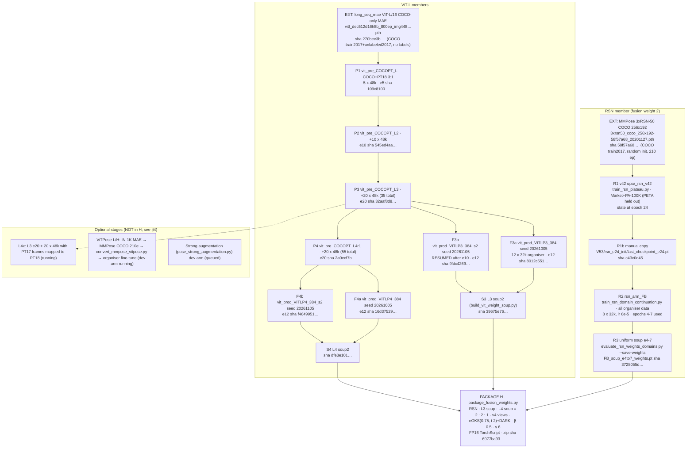

# Lineage of the current best package (candidate H) — 2026-10-12

Machine-readable index: `release_manifest.json`, generated by `tools/build_release_manifest.py` from the run files
(every value there carries its source path; re-run the tool after the final selection). This page is the human
summary of that index. Path abbreviations: `V42` = `artifacts/runs/20261005T025700+0900_mechanism_cycle_v42`,
`V53` = `artifacts/runs/20261006T003419+0900_resume_v53`, `V55` = `artifacts/runs/20261007T002451+0900_pretraining_survey_v55`,
`R` = `artifacts/runs/20261007T1540+0900_gold_cycle_v58`, `JOBS` = `.os_state/jobs`.

Package H (`R/20261011T1730_H_package.sh`, archive sha256 `6977ba93590d6ed06d763a0fe71c66355840f47b9a6f1d1c66faa0da05061209`)
has the same three TorchScript model files as the Public-scored submission **976064** (archive `35424c21…`, AP 0.8994);
only `run.py` constants differ (expected-OKS t 3 → 2, torso γ 4 → 6). H has **not** been run on Codabench (no receipt
anywhere in the repo; grep for "t2g6"/"6977ba93").

## 1. Graph

## 2. Stage table (values from `release_manifest.json`; sources there)

Config sha values are the `config_sha256` recorded in each run's `config.json`; every config file on disk still hashes to the recorded value (`config_file_sha256_now` in the manifest).

Common to every ViT/RSN stage run with `scripts/train_rsn_domain_continuation.py`: command
`env PYTHONPATH=artifacts/runs/20261003T185000+0900_strict_followup_v19/isolated_deps:src OMP_NUM_THREADS=1 MKL_NUM_THREADS=1 OPENBLAS_NUM_THREADS=1 .venv-gpu/bin/python -B scripts/train_rsn_domain_continuation.py --config <CONFIG>`
(`argv` of each `launch_*.json`; launched through `scripts/work_os.py launch`, which only adds the supervisor and
`CUDA_VISIBLE_DEVICES=0`). Crops 256×256, normalisation (x−0.5)/0.25, heatmap σ 2 (64 grid; redrawn for 96 grid),
bf16 autocast, TF32 off, AdamW, grad clip 1.0 (ViT). `warmup_epochs: 1` is a no-op in this trainer (factor
`min(1, epoch/1)` with epochs starting at 1, `scripts/train_rsn_domain_continuation.py` lines 427–433).

| ID | Stage (run dir) | Config | Init → sha256 | Data | Recipe | Seeds (seed / data) | Output used → sha256 | Monitor AP (role) | Time |
|---|---|---|---|---|---|---|---|---|---|
| EXT-R | MMPose 3×RSN-50 COCO | upstream `V42/rsn_upstream/3xrsn50_coco_256x192.py` (v0.29.0 copy; the checkpoint embeds the mmpose 0.8 config) | random init (`pretrained=None`) | COCO train2017 | 210 ep, Adam 5e-3, 8×V100 (embedded meta, `V42/rsn/initialization.json`, `V42/rsn_cpu_audit/upstream_metadata.json`) | None | `3xrsn50_coco.pth` → `58f57a688ca0eaae6f19d902e9f78522cf8e1db7ee74c677ae84ef35e4279561` | COCO val 0.750 (zoo) | UNKNOWN |
| R1 | `V42/rsn` (`upar_rsn_v42`) | `V42/rsn.json` sha `1c6dfb46…` | EXT-R (strict load; head_bottom/top channels re-initialised; final BN affine /255) | Market 12,923 + PA-100K 19,499 (PETA held out) | `scripts/train_rsn_plateau.py`, AdamW 2e-4, wd 1e-4, 3-epoch warm-up, plateau ×0.3 (6e-5 from e21), batch 16, factor synthesis + paste 0.35 | 20261005 / 20261903 (synthesis 20261039) | epoch-24 state (not saved in V42; see R1b) | PETA (all 10,314) AP 0.92917 at e24 (development) | 48,117 s training up to e24 (`V42/rsn/training_history.json`); controller job 61.1 h incl. SIGSTOPs |
| R1b | manual copy | — | — | — | — | — | `V53/rsn_e24_init/last_checkpoint_e24.pt` (model + AdamW) → `c43c0d45b8a5ccbfe99caff30fa147f7a2293bdb97fe05fa187482d8627e9c34` | — | copy command not recorded |
| R2 | `V53/rsn_arm_FB` | `V53/rsn_arm_FB.json` sha `1b942079…` | R1b (`init_mode` checkpoint: model + optimiser state) | all organiser data 42,736; Market 0.25, PA 0.25, 10 PETA cameras 0.05 each | 8 × 32k samples, batch 16, constant lr 6e-5, wd 1e-4 | 20261005 / 20261903 | e4–e7 → `88b2914c…`, `85308c0f…`, `31efd579…`, `08d0878e…` | hard5 0.9107 / 0.9085 / 0.9124 / 0.9107 (train-diagnostic: cameras inside the fit) | job 2.29 h, rc 0 (`JOBS/20261006T050617991966+0900_rsn_arm_FB`) |
| R3 | `V53/soup_eval` | — | R2 e4–e7 | — | uniform float64 average incl. BN statistics (`scripts/evaluate_rsn_weights_domains.py --weights … --save-weights`) | — | `FB_soup_e4to7_weights.pt` → `3728055d616bf4258b003bfaab1aa81bed0cbcfc82cbe8443f22745369108992` | hard5 0.91219 (train-diag); Public alone 0.8823 (963865) | minutes (CPU/GPU eval) |
| EXT-V | long_seq_mae ViT-L/16 | — | random init | COCO train2017 + unlabeled2017 images (no labels), 800 ep × dup5, 448 px | MAE | — | `data/external/coco_mae/vitl_coco_mae_448.pth` → `270bee3b98ca7c8a3108c2947a0d6f01a640708d57300b1f0b0ba37be1b75216` | — | UNKNOWN |
| P1 | `V53/vit_pre_COCOPT_L` | `V53/vit_pre_COCOPT_L.json` (sha `9899a327…`) | EXT-V (`init_mode` mae: decoder dropped, pos-embed 28→16) | COCO 123,202 + PT18 17,348 persons (≥6 joints, box h ≥32), sampled 0.75/0.25 | 5 × 48k, batch 32, lr 1e-4 → 3e-5 from e4, wd 0.1, layer decay 0.8, drop path 0.4, 256 px | 20261007 / 20261903 | e5 → `109c8100011f5d87b39db95e9dea2a5e6d234e0b737d2749db38fac5230a6b2a` | hard5 0.8381 (zero-shot, development) | job 3.05 h |
| P2 | `V53/vit_pre_COCOPT_L2` | `V53/vit_pre_COCOPT_L2.json` (sha `e4835901…`) | P1 e5 | as P1 | 10 × 48k, 3e-5 from e8 | 20261008 / 20261903 | e10 → `545ed4aadf5b279453d74b098a2f75d7c31e4d533c129482724cb2362c6f918d` | 0.8437 | job 5.81 h |
| P3 (L3) | `R/vit_pre_COCOPT_L3` | `R/vit_pre_COCOPT_L3.json` (sha `2daf590a…`) | P2 e10 | as P1 | 20 × 48k, 3e-5 from e17, grad checkpointing | 20261058 / 20261903 | e20 → `32aaf8d85bccac21cfe0f63a20e4e3b072a44ede9c7a3a611471c556af7f5794` | 0.8400 | job 13.44 h |
| P4 (L4) | `R/vit_pre_COCOPT_L4r1` | `R/vit_pre_COCOPT_L4r1.json` (sha `fe190d70…`) | P3 e20 | as P1 | 20 × 48k, as P3 | 20261059 / 20261904 | e20 → `2a0ecf7b3f8613f31991b012e1fe455c4a29a857f311c57dd65f93a5ae01d164` | 0.8451 | job 15.56 h |
| F3a | `R/vit_prod_VITLP3_384` | `R/vit_prod_VITLP3_384.json` (sha `71ab739d…`) | P3 e20 | all organiser data 42,736, sampling as R2 | 12 × 32k, batch 32, lr 1e-4 → 3e-5 from e9, wd 0.1, layer decay 0.8, drop path 0.4, `vit_image_size` 384 (24×24 tokens, 96×96 maps), factor synthesis + paste 0.35 | 20261005 / 20261903 | e12 → `8012c5512785a10da4c9d422acd86898e34c39903b239101a88703eb52369cbb` | 0.9567 (train-diag) | job 16.37 h |
| F3b | `R/vit_prod_VITLP3_384_s2` | `R/vit_prod_VITLP3_384_s2.json` (sha `c6e4e889…`) | P3 e20 | as F3a | as F3a; **disk-full crash in e11, resumed from the e10 checkpoint with `--resume`** outside Work OS | 20261105 / 20261913 | e12 → `9fdc4269bb86d9f3aa92503af59862f0b9e6348752d10d1214e851fd234b462a` | 0.9580 | 45,124 s of epoch time; Work OS status stale ("running") |
| F4a | `R/vit_prod_VITLP4_384` | `R/vit_prod_VITLP4_384.json` (sha `998bc902…`; generated inline by `R/auto_queue_v59g.sh`) | P4 e20 | as F3a | as F3a | 20261005 / 20261903 | e12 → `16d37529054e95fe78f9d6b26c2629a4d0ddc244ecc714f89dd1f1181aa4eaf4` | 0.9616 | job 4.16 h |
| F4b | `R/vit_prod_VITLP4_384_s2` | `R/vit_prod_VITLP4_384_s2.json` (sha `71b3f45e…`) | P4 e20 | as F3a | as F3a | 20261105 / 20261913 | e12 → `f4649951231d9dfaa088c9a99da63a87ef56ecb56775456ff8c70d414ceb17c9` | 0.9636 | job 4.11 h |
| S3 | `R/vit_prod_VITLP3_384_soup2` | — | F3a + F3b | — | `CUDA_VISIBLE_DEVICES= PYTHONPATH=src .venv-gpu/bin/python -B scripts/build_vit_weight_soup.py --weights <F3a e12> <F3b e12> --output …/soup_weights.pt` (`R/20261010T1015_soup2_after_s2.sh`) | — | `39675e7697de1b7032fb1db7b5d590c9653e44952421ccf02c1756ff401ae781` | none (no clean soup eval) | CPU, minutes |
| S4 | `R/vit_prod_VITLP4_384_soup2` | — | F4a + F4b | — | same tool (`R/20261011T0750_build_soups.sh`) | — | `dfe3e10128e58b72619a78f22d03f376f088f5ba44b41f9befd12a4fc4172523` | none | CPU, minutes |
| PK | `R/package_fusion3_H_Edp_t2g6` | `R/20261011T1730_H_package.sh` | R3, S3, S4 | — | `scripts/package_fusion_weights.py` (FP16 storage, DARK, eOKS 0.75/2, β 0.5, γ 6, v4 views, RSN CUDA graph, guard 0.21 s/img after 500) | — | zip `6977ba93…`; members `4e301f24…` (RSN), `5c5b20f2…` (L3 soup), `6736cf73…` (L4 soup), run.py `9bb47394…` | Public: 976064 twin 0.8994; H UNKNOWN | export dirs 17:16, report 17:18 JST 2026-10-11 (CPU) |

"hard5" = PETA cameras CAVIAR4REID, PRID, i-LID, GRID, SARC3D (2,314 persons), subset-mean AP. For the production
stages these cameras are inside the fit, so their AP is a train diagnostic, not a validation. The corresponding
development arms (`R/vit_arm_VITLP384_L3`, e12 0.89955; `R/vit_arm_VITLP384_L4`; RSN `V53/rsn_arm_PB_r1`) are listed in
`docs/paper/claims_ledger.md`.

Consistency of the recorded chain (`release_manifest.json` → `consistency_checks`, 16/16 pass): every stage's
`init_checkpoint_sha256` equals the parent's recorded output hash; every soup parent hash equals the parent run's
`validation_history.json` `weights_sha256`; each package member's `weights_sha256` equals the soup hash.

## 3. Hardware and wall-clock

One NVIDIA RTX PRO 6000 Blackwell Max-Q Workstation Edition (97,887 MiB), AMD Ryzen 9 9900X3D (24 threads), 123 GiB RAM,
shared with other jobs (GPU 96–99 % utilised at most launches, `R/host_for_*.json`). Times above are wall-clock under
contention (epoch times varied 816–5,839 s for the same recipe). Sum over the stages of H: ≈ 13.4 h (R1 to e24) + 2.3 h
(R2) + 3.1 + 5.8 + 13.4 + 15.6 h (P1–P4) + 16.4 + ≈ 14 + 4.2 + 4.1 h (F3a–F4b) ≈ 92 GPU-hours of shared-GPU wall-clock
(F3b counted as ≈ 14 h: 45,124 s of epoch time ≈ 12.5 h plus its validation; R1 counts training seconds only). Total ≈ 90 h; approximate, and inflated by sharing.

## 4. Optional stages (not in H; include in the release only if the final package uses them)

| Option | Status (2026-10-12 ~02:00) | Entry points / evidence |
|---|---|---|
| **L4x**: L3 e20 + 20 × 48k, PT18 annotations with official PoseTrack 2017 frames mapped to PT18 names (PT18 persons 17,348 → 75,596; 198,798 examples) | running (`JOBS/20261011T234340062989+0900_vit_pre_COCOPT_L4x`, e1–e2 done) | config `R/vit_pre_COCOPT_L4x.json` (`posetrack18_image_roots: [external/posetrack18, external/posetrack18_from_pt17]`); download `R/20261011T1940_posetrack17_mpi_download.sh`; extraction `R/20261011T2215_extract_pt17_frames_v2.py` (run with `python -I`); mapping check `R/20261011T2145_pt17_to_pt18_frames.py` → `…_verify.json` (PT18 frame k = PT17 frame k+1, 57 videos, MAD 0); placement `R/20261011T2230_pt17_to_pt18_place.json` (32,685 hard links into `data/external/posetrack18_from_pt17/`); provenance `R/20261011T1950_posetrack17_mpi_provenance.md` |
| **ViTPose IN-1K → COCO init** (ViTPose-L 384 / ViTPose-H 256) | dev arm `R/vit_arm_VITPOSEL_384` running (e3 hard5 0.9007, +0.0039 [−0.0009, +0.0078] vs L3 e3, `R/20261012T0200_vitposeL_e3_event.json`); `R/vit_prod_VITPOSEL_384.json` queued (`R/auto_queue_v64.sh`); ViT-H configs only | download `R/20261011T2010_in1k_coco_weights_download.sh/.log`; conversion `scripts/convert_mmpose_vitpose.py --source … --out … --grid … --seed 20261011 --provenance …` (exact command line NOT recorded) → `R/vitpose_in1k_coco/20261011T1950_vitpose{L,H}_coco_grid{16,24}.pt` + sidecar JSON; checks `R/vitpose_in1k_coco/20261011T2000_provenance.md`; packager labels such members `IN1KMAE_COCOViTPose_*` and needs `--external-pretraining-data` |
| **Strong augmentation** (`strong_augmentation` config key; MMPose-style geometry, photometric, CoarseDropout, blur/noise, test-like truncation) | dev arm `R/vit_arm_VITLP384_L3_SA.json` failed at start-up (CUDA OOM race), re-queued in v64; no result | `scripts/pose_strong_augmentation.py` (applied 2026-10-12 01:28 together with patches to `scripts/pose_research_data.py` and the trainer; README and tests in `artifacts/runs/20261012T0040_strong_aug_patch/`); key absent ⇒ bit-identical batches to the 2026-10-11 22:13 trainer (test A1–A4) |
| Head-only 0.7σ targets (h07) members | production runs `R/vit_prod_VITLP{3,4}_384_h07{,_s2}` exist | not adopted (L4 dev e9 +0.0000, ledger) |
